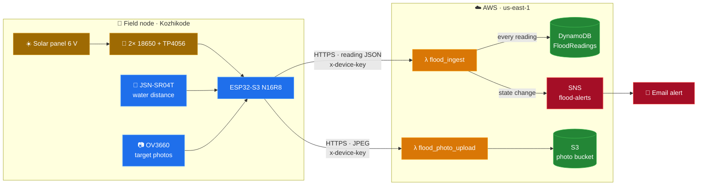

# Flood Monitor

Solar-powered flood level monitor built on an ESP32-S3 with an ultrasonic sensor
and camera, reporting to a serverless AWS backend.

## Architecture



## Phases

| Phase | Scope | Status |
|---|---|---|
| 1 | Distance monitoring, photos, DynamoDB, SNS alerts, S3 upload | Done |
| 2 | Weather API: device runs only when rain or storm alerts are active | Planned |
| 3 | Decision model: rain confidence decides whether to keep monitoring | Planned |

## Repository layout

```
firmware/        ESP32-S3 Arduino sketch
hardware/        Enclosure CAD, STL, renders and wiring
lambdas/         AWS Lambda functions (Python 3.12)
decision_model/  Phase 3
iam/             Least-privilege inline policies
docs/            Setup and notes for each phase
```

## Enclosure


Weatherproof case with solar panel roof. See hardware/enclosure/.

## Hardware

- ESP32-S3 N16R8 with OV3660 camera
- JSN-SR04T waterproof ultrasonic sensor (TRIG GPIO 1, ECHO GPIO 2, 3.3 V)
- Range 25 to 450 cm

## Security

- Secrets live in firmware/aws_distance_camera/secrets.h, which is git-ignored
- Function URLs reject requests without the shared device key
- Each Lambda role has only the permissions it needs (see iam/)

## Setup

See docs/phase1-monitoring.md.
